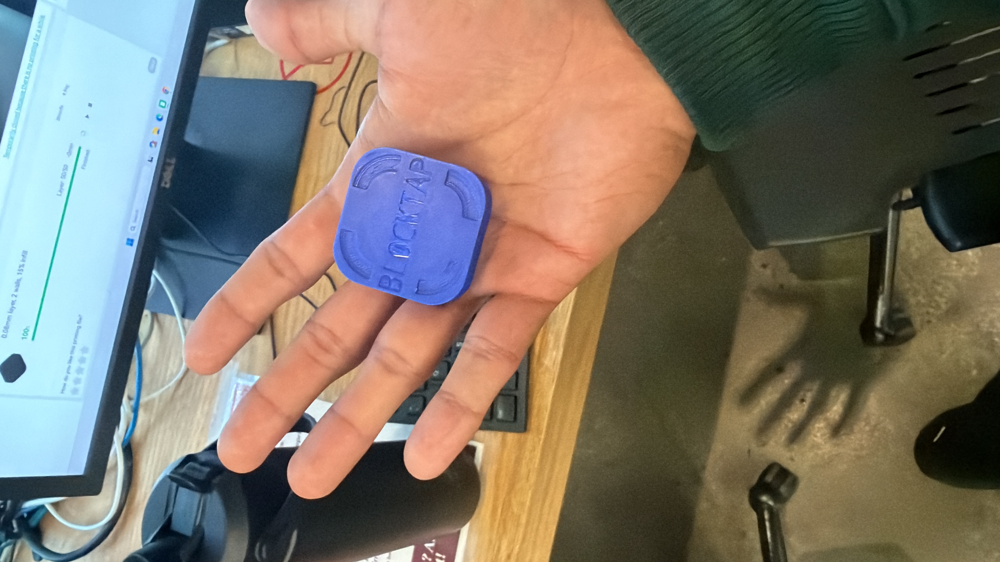

# Blocktap

landing. personal use

Credits: [foqos.app](https://foqos.app) · [Blocktap on MakerWorld](https://makerworld.com/en/models/2994823-blocktap-live-more-scroll-less-phone-app-blocker#profileId-3361747)

## Preorder waitlist

The product page links to `/waitlist.html`. The form saves email, name, delivery
address, product, $39 launch price, consent version, and signup time in the Convex
`waitlist` table. Joining costs $0; no payment or confirmation email is sent.
The old `/billing.html` URL forwards to the waitlist.

Manage entries in the [Convex project dashboard](https://dashboard.convex.dev/t/kk5241/blocktap).
Production deployment: `hip-dalmatian-530`. Development: `successful-tern-306`.
Select production and open **Data → waitlist** to see emails and associated addresses.
No public query exposes entries. Duplicate normalized emails return success without
changing an existing address. Address changes can be managed in the dashboard.

- `npm install` then `npm run check` validates frontend syntax and input handling.
- `npm run dev` serves the static site on port 3000.
- `npm run convex:dev` develops the backend (Convex login required).
- `npm run convex:deploy` publishes the backend to production.
- `cd dist && npx vercel deploy --prod` publishes the frontend.

The public HTTP endpoint is configured in `dist/waitlist-config.js`. For development,
point it at `https://successful-tern-306.convex.site/waitlist`; restore the production
URL before publishing. No Convex credentials belong in the frontend or repository.
The endpoint validates inputs, limits request size, allows the Blocktap origins
and localhost, and uses a honeypot. CORS and the honeypot are not full abuse protection.
